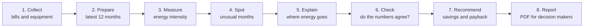
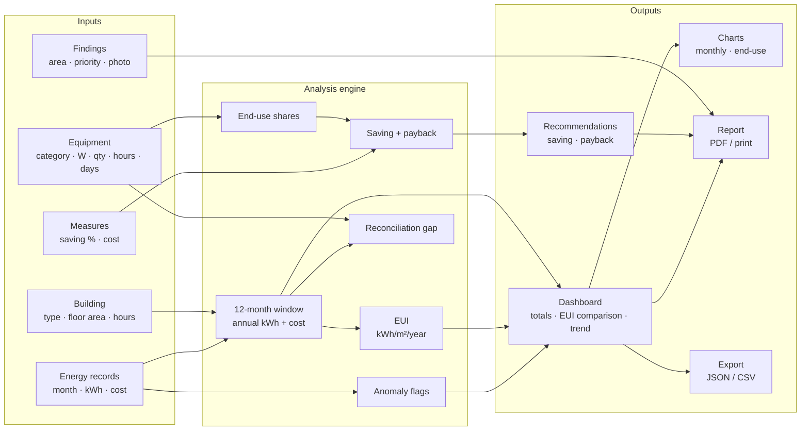

# Wattcheck

**Wattcheck turns a building's electricity bills and equipment list into clear answers: how much energy it uses, where it goes, what is going wrong, and what to fix first.**

It is built for schools, colleges, hospitals and offices that want to cut energy costs but do not have an energy specialist on staff.

## The idea in one picture

## Inputs, engine and outputs

## How data moves through the system

### 1. Collect

**What goes in:** for each building, its type and floor area; one row per month with energy used (kWh) and cost; and a list of equipment with power rating, quantity and hours of use. Monthly bills can be typed in or imported from a spreadsheet file.

**What comes out:** a clean, validated record of the building. Bad rows are flagged before anything is saved.

### 2. Prepare

**What happens:** the system takes the **latest 12 months** of bills and ignores older history, so every building is judged on a current, comparable year.

**What comes out:** total yearly energy use, total yearly cost, and the average price paid per kWh.

### 3. Measure

**What happens:** yearly energy is divided by floor area to give the building's **energy intensity** (EUI), meaning energy used per square metre. This allows fair comparison between big and small buildings.

**What comes out:** one intensity figure per building and a side-by-side comparison across the institution. If all 12 months are not available, the figure is withheld rather than shown misleadingly. If buildings are of different types, the comparison carries a fairness warning.

### 4. Spot

**What happens:** each month is compared with the average of the other months. A month that is far higher than usual is flagged.

**What comes out:** a list of unusual months, each showing how far above normal it was. These are highlighted on the charts.

### 5. Explain

**What happens:** each piece of equipment is turned into a yearly energy figure from its power, quantity and hours of use, then grouped (lighting, air conditioning, pumps and so on).

**What comes out:** an **end-use breakdown**, showing what share of the energy goes to each category.

### 6. Check

**What happens:** the energy the equipment list adds up to is compared with what the bills say was actually used.

**What comes out:** the size of the gap, with a warning if it is large. A big gap usually means equipment is missing from the list or is being used more than recorded.

### 7. Recommend

**What happens:** the user picks an improvement from a library (for example LED lighting, occupancy sensors, efficient air conditioners). The system estimates the yearly saving from the building's own costs and the share of energy that improvement touches, then works out how quickly it pays for itself.

**What comes out:** a recommendation with estimated cost, estimated yearly saving and **payback period in years**. Everything is labelled an estimate and can be adjusted.

### 8. Report

**What comes out:** a per-building audit report with key figures, a monthly chart, findings, recommendations and a conclusion, exportable to PDF. The institution-wide **dashboard** brings the same results together across all buildings.

## What the outputs look like

| Stage | Output |
|---|---|
| Collect | Validated building, bill and equipment records |
| Prepare | Yearly kWh, yearly cost, price per kWh |
| Measure | Energy intensity per building, comparison chart |
| Spot | Flagged unusual months |
| Explain | Share of energy by equipment category |
| Check | Gap between bills and equipment list, with warning |
| Recommend | Savings, cost and payback per improvement |
| Report | Audit report (PDF) and dashboard |

## App features

- **Multi-tenant institutions** with **Admin** (users, settings, deletion) and **Auditor** (create/edit audit data) roles.
- **Buildings** with type, floor area and operating hours.
- **Monthly energy records** entered by hand or imported from a CSV (`month,kwh,cost`) with per-row validation.
- **Equipment inventory** across 15 categories, with a common-equipment catalog to pre-fill typical ratings.
- **Reconciliation** of billed consumption against the equipment inventory, with a 15% tolerance warning.
- **Audit findings** by area, with priority and an optional JPG/PNG photo.
- **Recommendations** from a measure library, with estimated cost, estimated saving and automatic simple payback.
- **Dashboard** with annual totals, EUI comparison, monthly trend and flagged unusual months.
- **Reports** per building, exportable to PDF or printed, plus **JSON/CSV export** of the institution's own data.

## Good to know

- Savings and paybacks are **estimates**, not measured results.
- The system does not adjust for weather, forecast the future, or calculate carbon emissions.
- Each institution only sees its own data.

## More documentation

| Document | Read it for |
|---|---|
| [Features and user guide](docs/FEATURES.md) | What users can do and who can do it |
| [Formula reference](docs/FORMULAS.md) | Every calculation the engine uses |
| [Worked example](docs/WORKED_EXAMPLE.md) | One building followed through all the steps with numbers |
| [Technical documentation](docs/TECHNICAL.md) | Tech stack, architecture, data storage, security |
| [Setup guide](docs/SETUP.md) | Installing and running the app |
