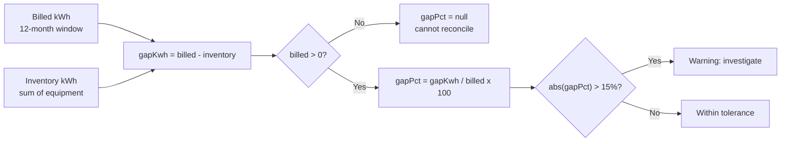
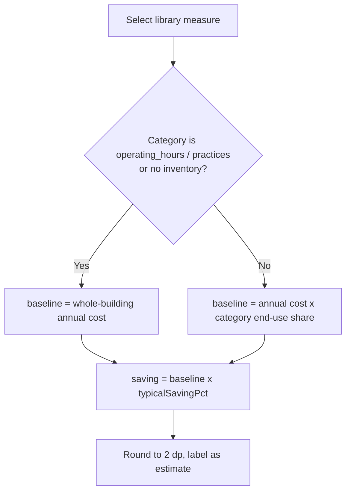

# Wattcheck: Formula Reference

Every calculation the analysis engine performs, in the order data flows through it. For a plain-language walkthrough, see the [README](../README.md); for a full numeric example, see [WORKED_EXAMPLE.md](WORKED_EXAMPLE.md).

## Contents

1. [Rolling 12-month window](#1-rolling-12-month-window)
2. [Annual totals and cost per kWh](#2-annual-totals-and-cost-per-kwh)
3. [Energy Use Intensity (EUI)](#3-energy-use-intensity-eui)
4. [Institution totals](#4-institution-totals)
5. [Anomaly detection](#5-anomaly-detection)
6. [Equipment annual consumption](#6-equipment-annual-consumption)
7. [End-use shares](#7-end-use-shares)
8. [Reconciliation](#8-reconciliation)
9. [Saving estimate](#9-saving-estimate)
10. [Simple payback](#10-simple-payback)
11. [Constants](#11-constants)

---

## 1. Rolling 12-month window

Annual figures use the 12 months ending at the building's most recent recorded month, not the full history.

$$
\text{start} = \text{end} - 11\ \text{months}
$$

$$
W = \{\, r : \text{start} \le r.\text{month} \le \text{end} \,\}
$$

- `monthsInPeriod` is the number of records inside the window (max 12).
- The window is **complete** when `monthsInPeriod = 12`.

## 2. Annual totals and cost per kWh

$$
\text{annualKwh} = \sum_{r \in W} r.\text{kwh}
\qquad
\text{annualCost} = \sum_{r \in W} r.\text{cost}
$$

$$
\text{costPerKwh} =
\begin{cases}
\dfrac{\text{annualCost}}{\text{annualKwh}}, & \text{annualKwh} > 0 \\
\text{null}, & \text{otherwise}
\end{cases}
$$

## 3. Energy Use Intensity (EUI)

$$
\text{EUI} = \frac{\text{annualKwh}}{\text{floorAreaM2}}
\quad \left[\mathrm{kWh\,/\,m^2\,/\,year}\right]
$$

- If `floorAreaM2 ≤ 0`, EUI is `null`.
- EUI is reported **only when the window is complete**; otherwise it is `null` and labelled `incomplete (n of 12 months recorded)`.

## 4. Institution totals

$$
\text{totalKwh} = \sum_{b} \text{annualKwh}_b
\qquad
\text{totalCost} = \sum_{b} \text{annualCost}_b
$$

If buildings have different types (case-insensitive), the comparison carries a fairness warning.

## 5. Anomaly detection

For each record $r$, with $n \ge 2$ records:

$$
\text{avgOthers}_r = \frac{\displaystyle\sum_i \text{kwh}_i - \text{kwh}_r}{n - 1}
$$

$$
\text{pctAbove}_r = \frac{\text{kwh}_r - \text{avgOthers}_r}{\text{avgOthers}_r} \times 100
$$

$$
\text{anomaly}_r \Longleftrightarrow \text{kwh}_r > \text{avgOthers}_r \,(1 + \tau)
$$

- Default $\tau = 0.30$ (30%), set by `ANOMALY_THRESHOLD`.
- If `n < 2` or `avgOthers ≤ 0`, nothing is flagged.
- Each month is compared with the *other* months so a spike cannot hide itself by inflating its own baseline.

## 6. Equipment annual consumption

$$
E_e = \frac{\text{ratingW}_e \times \text{qty}_e \times \text{hoursDay}_e \times \text{daysYear}_e}{1000}
\quad \left[\mathrm{kWh\,/\,year}\right]
$$

The `/1000` converts watts to kilowatts.

## 7. End-use shares

$$
\text{categoryKwh}_c = \sum_{e \in c} E_e
\qquad
\text{totalKwh} = \sum_{c} \text{categoryKwh}_c
$$

$$
\text{sharePct}_c =
\begin{cases}
\dfrac{\text{categoryKwh}_c}{\text{totalKwh}} \times 100, & \text{totalKwh} > 0 \\
0, & \text{otherwise}
\end{cases}
$$

Each equipment line also has `sharePct = E_e / totalKwh × 100`. Categories with no equipment do not appear.

## 8. Reconciliation

$$
\text{gapKwh} = \text{billedKwh} - \text{inventoryKwh}
$$

$$
\text{gapPct} =
\begin{cases}
\dfrac{\text{gapKwh}}{\text{billedKwh}} \times 100, & \text{billedKwh} > 0 \\
\text{null}, & \text{otherwise}
\end{cases}
$$

$$
\text{warning} \Longleftrightarrow \left|\text{gapPct}\right| > 15
$$

## 9. Saving estimate

$$
\text{baselineCost} =
\begin{cases}
\text{annualCost}, & \text{whole-building} \\
\text{annualCost} \times \dfrac{\text{endUseSharePct}}{100}, & \text{otherwise}
\end{cases}
$$

$$
\text{estimatedAnnualSaving} =
\mathrm{round}\left(\text{baselineCost} \times \frac{\text{typicalSavingPct}}{100},\ 2\right)
$$

`wholeBuilding` is **true** when the measure category is `operating_hours` or `practices`, or when no equipment inventory exists for that category.

### Built-in measures

| Measure | Category | Typical saving | Typical cost |
|---|---|---|---|
| LED lighting retrofit | lighting | 50% | 250,000 |
| Occupancy sensors | lighting | 25% | 80,000 |
| Efficient AC units | ac_ventilation | 30% | 600,000 |
| AC schedule / switch-off | ac_ventilation | 15% | 20,000 |
| VFD on pumps | motors_pumps | 30% | 350,000 |
| Power factor correction | other | 5% | 300,000 |
| Timer on water heating | other | 20% | 25,000 |
| Staff awareness programme | practices | 5% | 15,000 |

## 10. Simple payback

$$
\text{paybackYears} = \frac{\text{estimatedCost}}{\text{estimatedAnnualSaving}}
$$

Checked in this order:

| Condition | Result |
|---|---|
| `annualSaving ≤ 0` | `Not applicable` |
| `annualSaving > 0` and `cost ≤ 0` | `Immediate` (0 years) |
| `annualSaving > 0` and `cost > 0` | `cost / saving`, shown to 1 decimal place + "years" |

Saving is checked first so a zero saving always reads "Not applicable", even if the cost is also zero.

## 11. Constants

| Constant | Value | Where set |
|---|---|---|
| Months in window | 12 | engine |
| Anomaly threshold $\tau$ | 0.30 | `ANOMALY_THRESHOLD` |
| Reconciliation warning | 15% | `WARN_PCT` |
| Saving rounding | 2 decimal places | engine |
| Payback display | 1 decimal place | engine |
