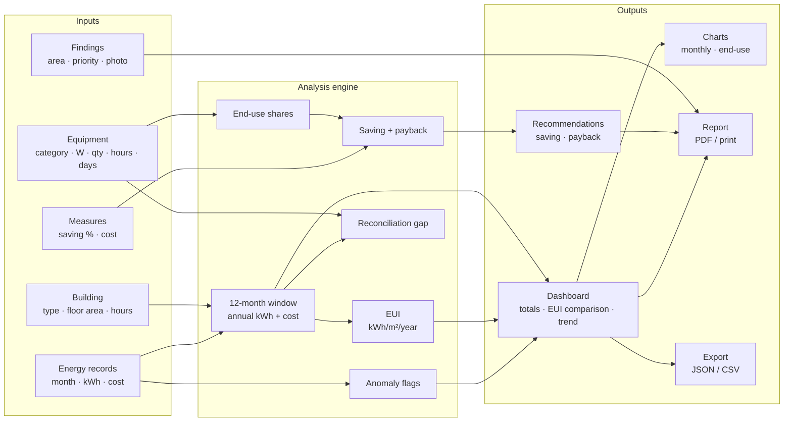

# Wattcheck

Wattcheck is a multi-institution energy-audit decision-support app for schools, colleges, hospitals and offices. It turns a building's electricity bills and equipment list into clear answers: how much energy it uses, where the energy goes, what looks wrong, and what to fix first.

Each institution only sees its own data. The app runs as a React (Vite) + Chart.js front end with a Node/Express + MongoDB back end.

## How it works

## App features

- **Multi-tenant institutions** with **Admin** (users, settings, deletion) and **Auditor** (create/edit audit data) roles.
- **Buildings**, **monthly energy records** (manual or CSV import), and **equipment inventory** (15 categories, catalog pre-fill).
- **Reconciliation** of bills vs. inventory with a 15% warning.
- **Audit findings** with priority and optional photo.
- **Recommendations** from a measure library with automatic simple payback.
- **Dashboard** with totals, EUI comparison, monthly trend and anomaly flags.
- **Reports** (PDF/print) and **JSON/CSV export**.

## Documentation

| Document | Read it for |
|---|---|
| [Features and user guide](FEATURES.md) | What users can do and who can do it |
| [Formula reference](FORMULAS.md) | Every calculation the engine uses |
| [Worked example](WORKED_EXAMPLE.md) | One building followed through all the steps with numbers |
| [Technical documentation](TECHNICAL.md) | Tech stack, architecture, data storage, security |
| [Setup guide](SETUP.md) | Installing, configuring and running the app |

## Good to know

- Savings and paybacks are **estimates**, not measured results.
- No weather normalisation, forecasting or carbon accounting.
- Data lives in **MongoDB**; tenant isolation is enforced in code by `tenantDb`.
