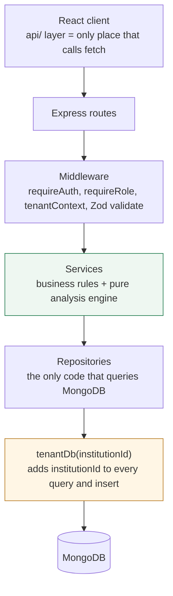
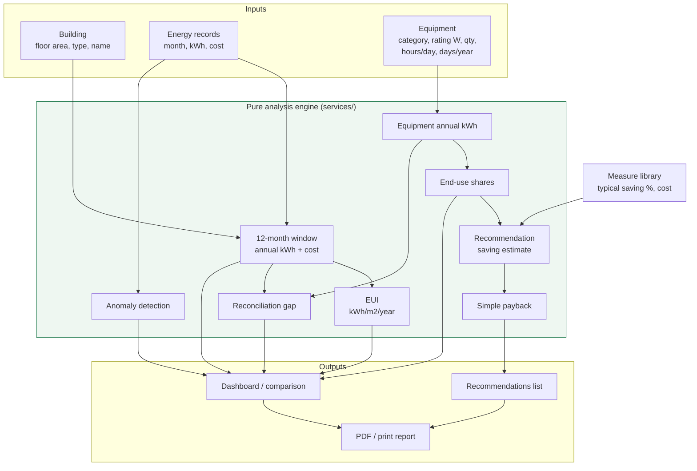
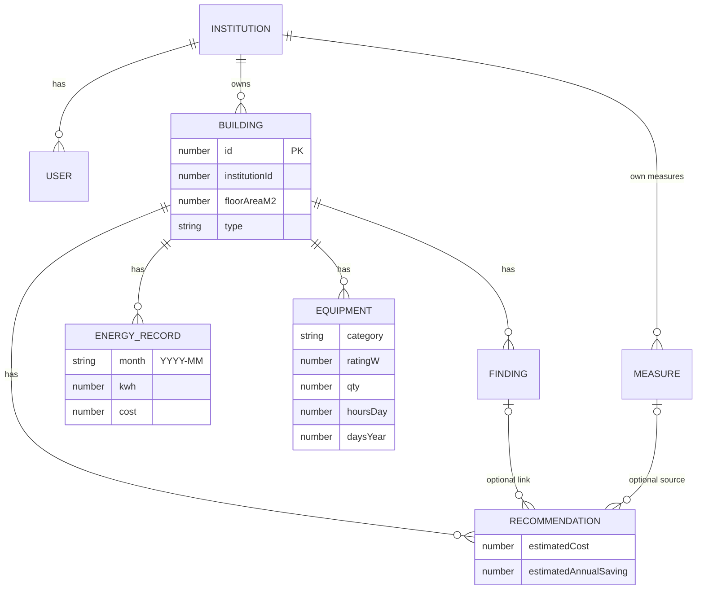

# Wattcheck: Technical Documentation

This document is for developers. It covers the tech stack, how the API is layered, the data model, how data is stored, and how tenants are kept apart. For the non-technical overview, see the [README](../README.md). For the maths, see [FORMULAS.md](FORMULAS.md).

## Contents

1. [Tech stack](#tech-stack)
2. [Architecture](#architecture)
3. [Analysis engine modules](#analysis-engine-modules)
4. [Data model](#data-model)
5. [Data storage](#data-storage)
6. [Tenant isolation](#tenant-isolation)
7. [Security and operations](#security-and-operations)

---

## Tech stack

| Layer | Technology |
|---|---|
| Front end | React (Vite), Chart.js |
| Back end | Node.js 18+, Express |
| Database | MongoDB 6+ (official `mongodb` driver; no replica set needed) |
| Validation | Zod |
| Authentication | bcrypt password hashing, JWT in an httpOnly cookie |
| Uploads | multer (finding photos) |
| PDF export | Puppeteer |
| Testing | Vitest + Supertest |

---

## Architecture

The server is layered. A request only ever moves downward, and **only repositories touch MongoDB**.

Request pipeline in order:

1. `requireAuth` verifies the JWT cookie.
2. `requireRole` checks Admin or Auditor permissions.
3. `tenantContext` builds the tenant-scoped database handle.
4. Zod validates the body, params and query.
5. A service applies business rules and calls the analysis engine.
6. A repository reads or writes MongoDB through the tenant handle.

---

## Analysis engine modules

The engine is implemented as **pure functions** in `server/src/services/`: no database access, no I/O. Plain data in, plain data out, which keeps it easy to test and reason about.

| File | Responsibility |
|---|---|
| `analysis.service.js` | 12-month window, annual totals, EUI, cross-building comparison |
| `anomaly.service.js` | Flags months that are unusually high |
| `reconciliation.service.js` | Equipment annual kWh, end-use shares, inventory-vs-billed gap |
| `payback.service.js` | Recommendation saving estimate and simple payback |

### Engine inputs

| Input | Fields used |
|---|---|
| **Building** | `floorAreaM2` (m²), `type`, `name` |
| **Energy records** | `month` (`YYYY-MM`), `kwh`, `cost` (one row per calendar month) |
| **Equipment** | `category`, `ratingW`, `qty`, `hoursDay`, `daysYear` |

### Validation bounds

- Equipment: `ratingW > 0`, `qty ≥ 1` (whole), `0 ≤ hoursDay ≤ 24`, `0 ≤ daysYear ≤ 366` (whole). No cap on equipment lines per building.
- Buildings: 100 per institution by default; an admin can raise the limit to 1000.

### Equipment categories (15)

`lighting`, `ac_ventilation`, `motors_pumps`, `ict`, `refrigeration`, `water_heating`, `kitchen_catering`, `office_equipment`, `medical_lab`, `laundry`, `lifts`, `audio_visual`, `workshop`, `security`, `other`.

Measure categories are these 15 plus `operating_hours` and `practices`.

---

## Data model

Every document carries an `institutionId` (except the institution itself). System measure presets have `institutionId: null`.

---

## Data storage

Data lives in **MongoDB**. Collections are created automatically; the server creates its unique indexes at start-up.

| Collection | Notes |
|---|---|
| `institutions` | name (unique), currency, `maxBuildings` |
| `users` | e-mail (unique, stored lower-case), role, password hash, `mustChangePassword` |
| `buildings` | unique name per institution |
| `energy_records` | `month` stored as `YYYY-MM`; unique per building and month |
| `equipment`, `findings`, `recommendations` | each linked to a building |
| `measures_library` | system presets (`institutionId: null`) plus each institution's own measures |
| `counters` | auto-increment counters, so ids stay simple numbers |

Integrity rules, enforced in code because MongoDB has no foreign keys:

- Deleting a building also deletes its records, equipment, findings and recommendations.
- Deleting a finding clears the link on recommendations that used it.
- Duplicate e-mails, institution names, building names and months are rejected by unique indexes and returned as friendly **409** responses.
- The building limit is checked just before insert (no row lock), so two simultaneous requests could, very rarely, exceed it by one.

---

## Tenant isolation

MongoDB has no row-level security, so isolation is enforced in code:

- The institution id is read **only from the verified JWT**, never from the URL or body.
- `tenantContext` creates `req.db = tenantDb(institutionId)`. That handle adds the institution id to **every** query (last, so a caller cannot override it) and stamps it onto every insert.
- Only repositories use the handle, and routes → services → repositories is the only call path.
- System measure presets are readable by every institution but never writable.
- Login and sign-up (no tenant yet) use small dedicated repository functions.
- Another institution's record behaves as if it does not exist (**404**).

`tests/isolation` checks that one institution cannot read, change or delete another's documents, even with a forged filter.

---

## Security and operations

- JWT in an httpOnly cookie; set `COOKIE_SECURE=true` behind HTTPS.
- Login rate limiting (`LOGIN_RATE_MAX`, default 10).
- Zod validation on every input.
- New auditors get a one-time temporary password and must change it at first login. No e-mail is sent.
- Finding photos (JPG/PNG, up to 5 MB) are stored in `server/uploads/<institutionId>/` and served only through an authenticated route.
- Tests (Vitest + Supertest) cover the formulas, validation, roles and cross-tenant isolation, and run against a separate database whose name must end in `_test`.

Setup and configuration live in [SETUP.md](SETUP.md).
